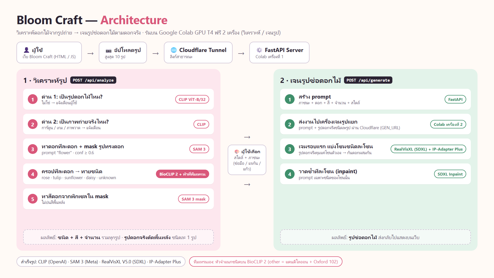
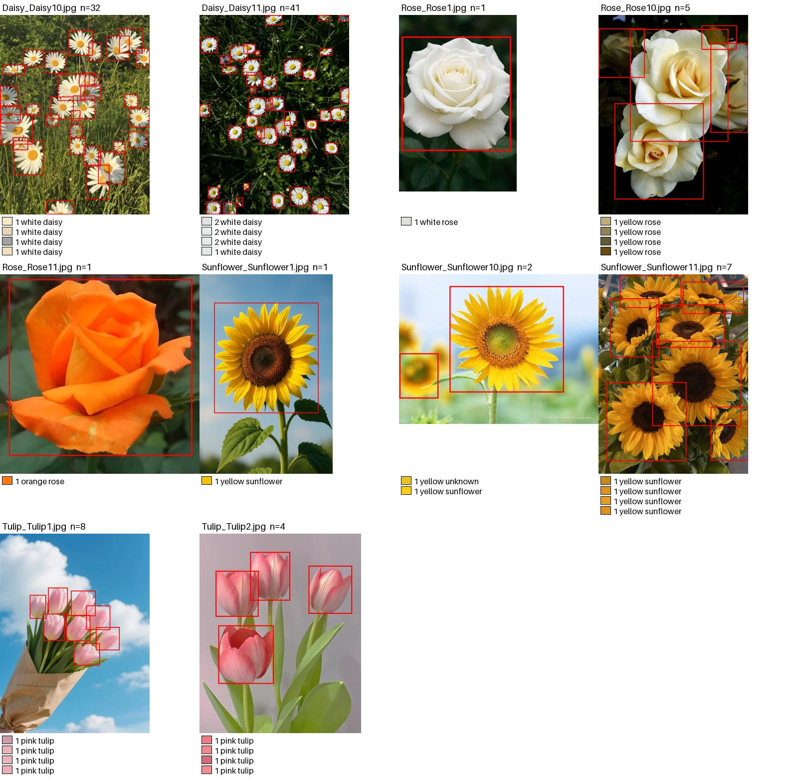

# 🌸 Bloom Craft

**INT182 กลุ่ม 1** · ถ่ายรูปดอกไม้ → AI **หาดอกทุกดอก นับจำนวน บอกชนิด บอกสี** → เลือกสไตล์และภาชนะ → **เจนรูปช่อดอกไม้** โดยใช้ดอกจริงจากรูปเป็นตัวอ้างอิง

ชนิดที่รองรับ: **rose · tulip · sunflower · daisy** (ชนิดอื่นตอบ `unknown`) · รูปการ์ตูน เกม ภาพวาด และรูปที่ไม่ใช่ดอกไม้จะถูกปัดตก

🎬 **วิดีโอทดลองใช้ระบบ:** [คลิปที่ 1](https://drive.google.com/file/d/1TkmOw-7vC7fQaKcrk0DXMwbGnM7F5bpb/view?usp=sharing) · [คลิปที่ 2](https://drive.google.com/drive/folders/1dJ1DBuRoGeG14hyJo1EJMyuAaPi-MMaj?usp=drive_link) (Google Drive)

---

## ▶️ วิธีรัน (Google Colab ฟรี 2 บัญชี)

| ลำดับ | Notebook | ทำอะไร |
|---|---|---|
| 1 |  `bloom_craft_gen_sdxl.ipynb` | เครื่องเจนรูป (SDXL) · บัญชี A |
| 2 |  `flower_counter_demo_4ชนิด_v6_แบ่งโซน.ipynb` | วิเคราะห์รูป + เว็บ Bloom Craft · บัญชี B |

1. **บัญชี A:** เปิด notebook 1 → Runtime → Change runtime type → **T4 GPU** → Run all → คัดลอกลิงก์ `GEN_URL = 'https://….trycloudflare.com'`
2. **บัญชี B:** ตั้ง Colab Secret ชื่อ `HF_TOKEN` (เปิด Notebook access · ต้องขอสิทธิ์ใช้ [SAM 3](https://huggingface.co/facebook/sam3) ก่อน)
3. เปิด notebook 2 → ใส่ลิงก์จากข้อ 1 ใน `GEN_URL = "..."` (ข้อ 2 ตั้งค่า) → **T4 GPU** → Run all
4. เปิดลิงก์เว็บที่ notebook 2 พิมพ์ออกมา (เปิดจากมือถือได้)

> แยก 2 เครื่องเพราะ SAM 3 + SDXL อยู่เครื่องเดียวกันแล้วแรม Colab ฟรีเต็ม · ถ้าเครื่องเจนรูปหลุดแล้วได้ลิงก์ใหม่ แค่สั่ง `GEN_URL = "ลิงก์ใหม่"` ในเครื่อง 2 ไม่ต้องรันใหม่

---

## 🧠 โมเดล

| ขั้น | โมเดล | หมายเหตุ |
|---|---|---|
| กรองรูป (ดอกไม้จริงไหม) | CLIP ViT-B/32 (OpenAI) | สำเร็จรูป |
| หาดอก + mask | SAM 3 (Meta) + ตัวกรองของเรา | conf ≥ 0.6 · ตัดกล่องเล็กกว่า 5% ของดอกที่ใหญ่สุด |
| บอกชนิด | **BioCLIP 2 + head ที่ทีมเทรน** | Linear 768 → 5 คลาส |
| บอกสี | คำนวณจากพิกเซลใน mask | ไม่ใช้ AI |
| เจนช่อดอกไม้ | RealVisXL V5.0 (SDXL) + IP-Adapter Plus | แบ่งโซนชนิดละโซน + วาดซ้ำทีละโซน |

## 📊 ผลลัพธ์

**หาดอก** (รูปทดสอบ 23 รูป นับเฉลยด้วยมือ · ยิ่งน้อยยิ่งดี)

| โมเดล | นับผิดรวม (ดอก) | นับตรงทั้งรูป |
|---|---|---|
| YOLO11 ที่เราเทรน | 31 | 10/23 |
| YOLO + OWLv2 | 32 | 10/23 |
| SAM 3 (ไม่กรอง) | 28 | 10/23 |
| OWLv2 (Google) | 23 | 12/23 |
| **SAM 3 + ตัวกรองของเรา** ✓ | **13** | **15/23** |

**บอกชนิด** (Test 672 รูป · 5 คลาส: daisy, rose, sunflower, tulip, other)

| โมเดล | Accuracy | Macro-F1 | ดอกที่ไม่เคยเห็น → other |
|---|---|---|---|
| BioCLIP 2 zero-shot | 89.3% | 0.899 | 98.3% |
| YOLO11n-cls (เราเทรน) | 93.1% | 0.927 | 90.8% |
| **BioCLIP 2 + head (เราเทรน)** ✓ | **97.3%** | **0.973** | **99.2%** |

Confusion matrix และกราฟ: [`results/species_eval_v2/`](results/species_eval_v2/)

## 📁 โครงสร้าง

| โฟลเดอร์ / ไฟล์ | คืออะไร |
|---|---|
| `bloom_craft_gen_sdxl.ipynb` | ⭐ เครื่องเจนรูป |
| `flower_counter_demo_4ชนิด_v6_แบ่งโซน.ipynb` | ⭐ วิเคราะห์รูป + เว็บ |
| `เว็บ_Bloom_Craft/` | หน้าเว็บ (HTML / CSS / JS) |
| `training/` | สคริปต์แบ่งข้อมูลและเทรนตัวบอกชนิด · notebook เทรน YOLO / ทดลอง SAM 3 |
| `runs/` | น้ำหนักโมเดลที่เทรน (head BioCLIP 2, YOLO) |
| `results/` | confusion matrix · กราฟ · รูปผลเดโม · แผนภาพ |
| `test_images/` + `เฉลยรูปทดสอบ.json` | รูปทดสอบ 23 รูป + จำนวนดอกเฉลย |
| `demo_รูป/` | รูปที่ใช้สาธิต |
| `ส่งงาน/` | โจทย์ + เนื้อหาสไลด์ |
| `old_versions/` | notebook / เว็บรุ่นก่อน + [บันทึกการทำงานละเอียด](old_versions/README_บันทึกการทำงาน.md) |

**เทรนตัวบอกชนิดซ้ำ:** `training/1_split_tfflowers.py` → `1b_build_v2_with_oxford.py` → `2_train_yolo_cls.py v2` → `3_bioclip_head_and_eval.py v2`

## 📚 Reference

- SAM 3 – Meta AI · [facebook/sam3](https://huggingface.co/facebook/sam3)
- BioCLIP 2 – Imageomics · [imageomics/bioclip-2](https://huggingface.co/imageomics/bioclip-2)
- CLIP – OpenAI · [open_clip](https://github.com/mlfoundations/open_clip)
- OWLv2 – Google · [google/owlv2-base-patch16-ensemble](https://huggingface.co/google/owlv2-base-patch16-ensemble)
- YOLO11 – [Ultralytics](https://github.com/ultralytics/ultralytics)
- RealVisXL V5.0 – [SG161222/RealVisXL_V5.0](https://huggingface.co/SG161222/RealVisXL_V5.0)
- IP-Adapter – Ye et al. (2023) · [h94/IP-Adapter](https://huggingface.co/h94/IP-Adapter)
- TF Flowers – [TensorFlow Datasets](https://www.tensorflow.org/datasets/catalog/tf_flowers)
- Oxford 102 Flowers – Nilsback & Zisserman (2008) · [VGG Oxford](https://www.robots.ox.ac.uk/~vgg/data/flowers/102/)
- Bouquet / flower-count – [Roboflow Universe](https://universe.roboflow.com)
